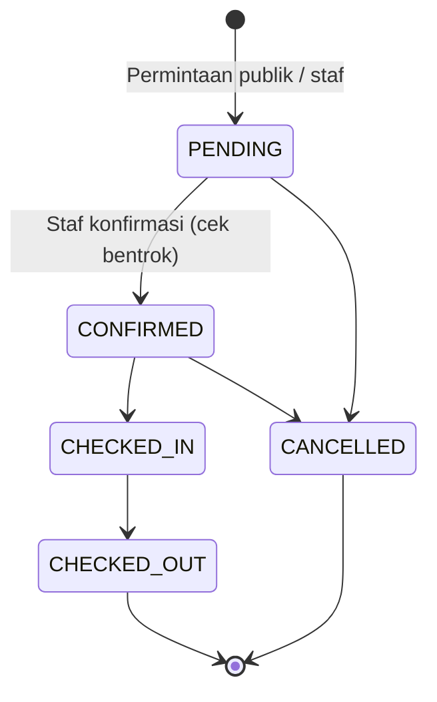
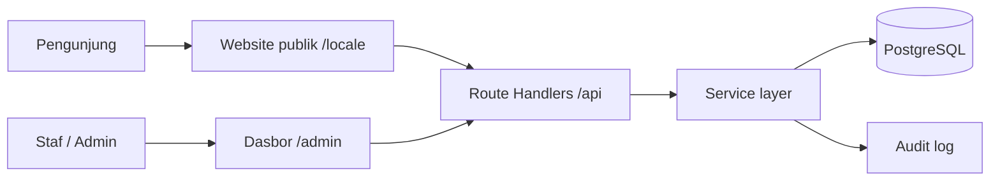

# Sagara Villas — Villa Booking Management System (Portfolio 02)

Sistem manajemen reservasi villa _full-stack_ untuk operator beberapa unit: website publik dengan katalog unit, dasbor admin, kalender, data tamu, pencatatan pembayaran manual, dan laporan. Proyek demonstrasi portofolio, kelanjutan dari Portfolio 01 (Nayana Villa).

> **Status:** fase dokumentasi. Kode belum dibangun. Semua perintah di bawah adalah **target** dan akan valid setelah Milestone M0–M1 selesai (lihat `IMPLEMENTATION.md`). Tidak ada klaim hasil tes sebelum tes benar-benar dijalankan.

---

> [!IMPORTANT]
>
> ### PEMBERITAHUAN DEMO / DEMO DISCLAIMER
>
> **ID:** **Sagara Villas adalah proyek portofolio fiktif.** Bukan properti atau bisnis yang beroperasi. Seluruh nama unit, tarif, tamu, foto, dan kontak adalah materi simulasi. Permintaan reservasi yang dikirim lewat demo ini tersimpan di database demo dan **bukan** reservasi yang terkonfirmasi.
>
> **EN:** **Sagara Villas is a fictional portfolio project.** It is not an operating property or business. All units, rates, guests, photos, and contact details are simulated. Booking requests submitted in this demo are stored in a demo database and are **not** confirmed reservations.

---

## 1. Ringkasan

| Aspek               | Keputusan                                                                 |
| ------------------- | ------------------------------------------------------------------------- |
| Brand               | Sagara Villas (fiktif) · _Calm Stays, Close to the Shore._                |
| Pengguna            | Tamu publik (EN/ID), Staf reservasi, Admin/Owner                          |
| Alur booking publik | Tamu mengirim **permintaan** → tersimpan `PENDING` → staf mengonfirmasi   |
| Pembayaran          | Dicatat **manual** oleh staf; tanpa payment gateway                       |
| Status pembayaran   | `UNPAID` · `PARTIAL` · `PAID` (dihitung otomatis dari catatan pembayaran) |
| Anti-double-booking | _Exclusion constraint_ PostgreSQL + transaksi + _row lock_                |
| Desain              | Shoreline Calm (Cormorant Garamond + DM Sans, palet teal/biru)            |

## 2. Peta Dokumentasi

Baca sesuai kebutuhan; setiap dokumen memakai ID yang bisa dicari (`BR-`, `FR-`, `NFR-`, `SEC-`, `TC-`).

| Dokumen                                       | Isi                                                                                  | Pakai saat                   |
| --------------------------------------------- | ------------------------------------------------------------------------------------ | ---------------------------- |
| [`AGENTS.md`](AGENTS.md)                      | Aturan kerja agen AI, kebijakan skills, definisi selesai                             | Awal setiap sesi             |
| [`PRD.md`](docs/PRD.md)                       | Tujuan, ruang lingkup P0/P1/P2, aturan bisnis `BR-01…15`, kebutuhan `FR-` dan `NFR-` | Memahami _apa_ yang dibangun |
| [`DESIGN.md`](docs/DESIGN.md)                 | Token warna & tipografi, pola halaman publik dan admin, kalender, status             | Membangun UI                 |
| [`CONTENT_GUIDE.md`](docs/CONTENT_GUIDE.md)   | Brand, nada, istilah EN/ID, klaim terlarang, kebijakan gambar                        | Menulis teks & data demo     |
| [`DATABASE.md`](docs/DATABASE.md)             | Skema Prisma, constraint SQL, resep transaksi, tabel status pembayaran               | Model data & migrasi         |
| [`API.md`](docs/API.md)                       | Endpoint publik/admin, format error, aturan laporan                                  | Backend & integrasi UI       |
| [`SECURITY.md`](SECURITY.md)                  | Kontrol `SEC-01…19`, matriks peran, checklist rilis                                  | Auth, validasi, hardening    |
| [`IMPLEMENTATION.md`](docs/IMPLEMENTATION.md) | Stack, struktur folder, milestone M0–M10, format laporan                             | Perencanaan pengerjaan       |
| [`TESTING.md`](docs/TESTING.md)               | Kasus uji `TC-`, matriks viewport, _release gate_                                    | Verifikasi                   |
| [`DEPLOYMENT.md`](docs/DEPLOYMENT.md)         | Vercel + Postgres, env, migrasi produksi, smoke test, backup                         | Rilis                        |

**Urutan baca disarankan:** README → PRD → DATABASE → API → SECURITY → DESIGN → CONTENT_GUIDE → IMPLEMENTATION → TESTING → DEPLOYMENT. Agen AI memulai dari `AGENTS.md`.

## 3. Fitur Utama

**Website publik** — katalog beberapa unit, detail unit (galeri, fasilitas, aturan menginap, lokasi ilustratif), tanggal tersedia, estimasi harga, permintaan reservasi, dwibahasa EN/ID, SEO.

**Dasbor admin** — login & peran (`ADMIN`/`STAFF`), ringkasan harian, kalender _timeline_ per unit, manajemen reservasi dengan alur status, data tamu, pembayaran manual (catat, _void_, refund), laporan (reservasi, pembayaran & sisa tagihan, okupansi, kedatangan/keberangkatan) dengan ekspor CSV, audit log.

**Bukan bagian MVP** — pembayaran online, sinkronisasi OTA, akun tamu, pengiriman email/WhatsApp otomatis, multi-properti.

## 4. Alur Status



Status pembayaran terpisah dan selalu diturunkan dari total pembayaran bersih dibanding total tagihan (`BR-09`).

## 5. Arsitektur Singkat



Aturan: **handler → service → Prisma**. Logika bisnis hanya di _service layer_.

## 6. Tech Stack

Next.js (App Router) · TypeScript strict · Tailwind CSS · shadcn/ui (selektif) · next-intl · PostgreSQL · Prisma · Auth.js (Credentials) · Zod · React Hook Form · TanStack Table · Vitest · Playwright · Vercel.

## 7. Memulai (target setelah M0–M1)

Prasyarat: Node.js LTS, npm, Docker.

```bash
npm install
cp .env.example .env.local     # isi nilai; jangan commit
npm run db:up                  # Postgres lokal
npm run db:migrate             # skema + constraint
npm run db:seed                # data fiktif (butuh SEED_ADMIN_* di env)
npm run dev
```

Variabel lingkungan ringkas (daftar lengkap di `DEPLOYMENT.md`): `DATABASE_URL`, `DIRECT_URL`, `AUTH_SECRET`, `AUTH_URL`, `NEXT_PUBLIC_SITE_URL`, `PROPERTY_TIMEZONE`, `SEED_ADMIN_EMAIL`, `SEED_ADMIN_PASSWORD`.

> Tidak ada kredensial bawaan. Kredensial demo dibagikan secara privat, bukan di README.

## 8. Peta Jalan (Milestone)

| #   | Milestone                          | Fokus                                                             |
| --- | ---------------------------------- | ----------------------------------------------------------------- |
| M0  | Repositori & lingkungan            | Setup proyek, Docker Postgres                                     |
| M1  | Fondasi database                   | Skema, constraint, seed, tes constraint                           |
| M2  | Autentikasi & otorisasi            | Login, peran, lockout                                             |
| M3  | Service inti                       | Harga, ketersediaan, reservasi, pembayaran, audit; tes konkurensi |
| M4  | Design system & shell admin        | Token, komponen, navigasi                                         |
| M5  | Admin: reservasi, tamu, pembayaran | Alur kerja harian                                                 |
| M6  | Admin: kalender & unit             | Timeline, blokir tanggal, CRUD unit                               |
| M7  | Dasbor & laporan                   | Ringkasan, 4 laporan, CSV aman                                    |
| M8  | Website publik                     | Katalog, detail, permintaan reservasi, SEO                        |
| M9  | P1 & hardening                     | Tarif musiman, anonimisasi, dll.                                  |
| M10 | QA, deploy, handover               | Release gate, produksi                                            |

## 9. Skills yang Direkomendasikan untuk Agen Implementasi

Dipakai: `better-typography`, `better-layout`, `better-colors`, `better-accessibility`, `better-ui`, `shadcn-ui`, `extract-design-md`, `hallmark`, serta satu dari `archify` / `diagram-design`. Selektif: `ui-ux-pro-max`, `taste-skill` (hanya halaman publik), `stitch-loop` (jika Stitch MCP aktif). Tidak dipakai: `scroll-world`, `frontend-slides`, _site cloner_. Rincian dan batasan keamanan ada di `AGENTS.md` §6 dan `DESIGN.md` §13.

## 10. Adaptasi untuk Klien Nyata

1. Ganti nama brand, teks (`messages/*.json`), dan data seed dengan konten operator nyata.
2. Ganti semua gambar dengan foto berlisensi dan isi manifest aset.
3. Tinjau kebijakan privasi, retensi data, dan kepatuhan hukum dengan profesional yang berwenang.
4. Nonaktifkan skrip _reset demo_ dan seed produksi.
5. Opsional: payment gateway, notifikasi email/WhatsApp, sinkronisasi OTA (di luar cakupan MVP).

## 11. Lisensi dan Atribusi Aset

Karya portofolio demonstrasi. Setiap gambar wajib tercatat sumber, lisensi, dan kredit di `docs/ASSETS.md` dan tabel `UnitImage`. Gambar referensi desain hanya dipakai sebagai acuan struktur, tanpa menyalin aset.
