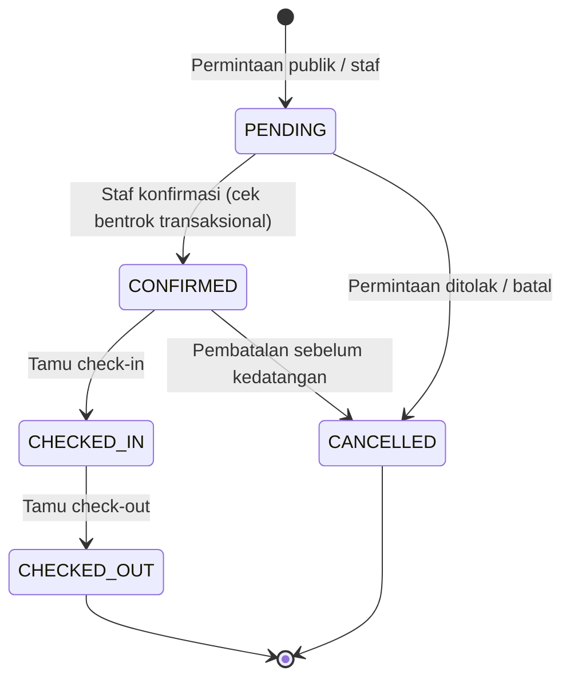
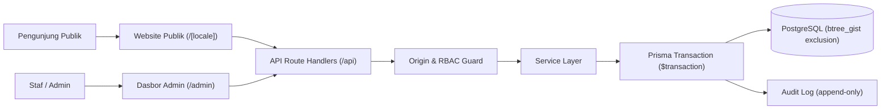

# Sagara Villas — Villa Booking Management System (Portfolio 02)

Sistem manajemen reservasi villa _full-stack_ untuk operator beberapa unit: website publik dengan katalog unit, kalender ketersediaan, alur permintaan booking, dasbor admin lengkap, kalender _timeline_, manajemen tamu, pencatatan pembayaran manual, ekspor laporan CSV aman dari formula injection, dan audit trail per mutasi. Proyek demonstrasi portofolio standar produksi, kelanjutan dari Portfolio 01 (Nayana Villa).

> **Status:** Selesai & Terverifikasi (Milestone M0–M10). 100% tes lulus (108 tes di 17 berkas uji), 0 kesalahan linter, 0 kesalahan tipe TypeScript, dan kompilasi produksi Next.js terverifikasi.

---

> [!IMPORTANT]
>
> ### PEMBERITAHUAN DEMO / DEMO DISCLAIMER
>
> **ID:** **Sagara Villas adalah proyek portofolio fiktif.** Bukan properti atau bisnis yang beroperasi. Seluruh nama unit, tarif, tamu, foto, dan kontak adalah materi simulasi. Permintaan reservasi yang dikirim lewat demo ini tersimpan di database demo dan **bukan** reservasi yang terkonfirmasi.
>
> **EN:** **Sagara Villas is a fictional portfolio project.** It is not an operating property or business. All units, rates, guests, photos, and contact details are simulated. Booking requests submitted in this demo are stored in a demo database and are **not** confirmed reservations.

---

## 1. Ringkasan Sistem

| Aspek               | Keputusan & Spesifikasi                                                   |
| ------------------- | ------------------------------------------------------------------------- |
| Brand               | Sagara Villas (fiktif) · _Calm Stays, Close to the Shore._                |
| Pengguna            | Tamu publik (EN/ID), Staf reservasi, Admin/Owner                          |
| Alur booking publik | Tamu mengirim **permintaan** → tersimpan `PENDING` → staf konfirmasi      |
| Pembayaran          | Dicatat **manual** oleh staf (`BANK_TRANSFER`, `CASH`, `QRIS`, `CARD_EXTERNAL`) |
| Status pembayaran   | `UNPAID` · `PARTIAL` · `PAID` (dihitung otomatis dari catatan pembayaran) |
| Anti-double-booking | _Exclusion constraint_ PostgreSQL (`gist`) + transaksi + _row lock_        |
| Concurrency         | Optimistic concurrency control via `version` & `If-Match` header          |
| Desain & A11y       | Shoreline Calm (`Cormorant Garamond` + `DM Sans`, palet teal/biru, WCAG)   |
| Hardening           | CSP ketat, X-Frame-Options DENY, no-store admin, noindex, sanitasi CSV    |

## 2. Peta Dokumentasi

Setiap dokumen memakai ID pelacakan yang dapat dicari (`BR-`, `FR-`, `NFR-`, `SEC-`, `TC-`).

| Dokumen                                       | Isi                                                                                  | Pakai saat                   |
| --------------------------------------------- | ------------------------------------------------------------------------------------ | ---------------------------- |
| [`AGENTS.md`](AGENTS.md)                      | Aturan kerja agen AI, kebijakan skills, definisi selesai                             | Awal setiap sesi             |
| [`PRD.md`](docs/PRD.md)                       | Tujuan, ruang lingkup P0/P1/P2, aturan bisnis `BR-01…15`, kebutuhan `FR-` dan `NFR-` | Memahami _apa_ yang dibangun |
| [`DESIGN.md`](docs/DESIGN.md)                 | Token warna & tipografi, pola halaman publik dan admin, kalender, status             | Membangun UI                 |
| [`CONTENT_GUIDE.md`](docs/CONTENT_GUIDE.md)   | Brand, nada, istilah EN/ID, klaim terlarang, kebijakan gambar                        | Menulis teks & data demo     |
| [`DATABASE.md`](docs/DATABASE.md)             | Skema Prisma, constraint SQL, resep transaksi, tabel status pembayaran               | Model data & migrasi         |
| [`API.md`](docs/API.md)                       | Endpoint publik/admin, format error, aturan laporan                                  | Backend & integrasi UI       |
| [`SECURITY.md`](docs/SECURITY.md)             | Kontrol `SEC-01…19`, matriks peran, checklist rilis                                  | Auth, validasi, hardening    |
| [`IMPLEMENTATION.md`](docs/IMPLEMENTATION.md) | Stack, struktur folder, milestone M0–M10, format laporan                             | Perencanaan pengerjaan       |
| [`TESTING.md`](docs/TESTING.md)               | Kasus uji `TC-`, matriks viewport, _release gate_                                    | Verifikasi                   |
| [`DEPLOYMENT.md`](docs/DEPLOYMENT.md)         | Vercel + Postgres, env, migrasi produksi, smoke test, backup                         | Rilis & operasional          |

## 3. Fitur Utama

- **Website Publik:**
  * Beranda, katalog unit villa, detail unit lengkap (galeri foto berlisensi, spesifikasi, fasilitas, aturan rumah).
  * Pemilih tanggal responsif ketersediaan, kalkulator estimasi tarif dan rincian harga.
  * Formulir permintaan reservasi (status awal `PENDING`, perlindungan bot via honeypot).
  * Dwibahasa penuh (English / Bahasa Indonesia) dan SEO teroptimasi (`sitemap.xml`, `robots.txt`, metadata OpenGraph).
- **Dasbor Admin:**
  * Autentikasi aman berbasis peran (`ADMIN` dan `STAFF`), proteksi brute-force lockout (5 kegagalan = 15 menit terkunci).
  * Ringkasan operasional harian (kedatangan hari ini, kepulangan, tamu menginap, permintaan pending, saldo tertunda, okupansi 30 hari).
  * Kalender visual _resource timeline_ per unit dengan deteksi tumpang tindih dan indikator status masa inap.
  * Manajemen reservasi lengkap dengan kontrol versi optimistik (`If-Match`), transisi status tervalidasi, dan indikator basi permintaan pending (>24 jam).
  * Manajemen data tamu dengan fitur pencarian dan hak penghapusan privasi (anonimisasi tamu sesuai SEC-10).
  * Pencatatan pembayaran manual, pembatalan pembayaran (_void_), pelacakan pengembalian dana (_refund_).
  * Laporan performa bisnis komprehensif (Reservasi, Pembayaran & Saldo, Okupansi, Kedatangan & Kepulangan) dengan ekspor CSV formula-safe dan tampilan cetak tanpa dark mode.
  * Pengaturan unit villa, aturan tarif musiman (_seasonal rate rules_), blok pemeliharaan (_maintenance blocks_), dan jejak audit tak terhapuskan (_audit log_).

## 4. Alur Status Reservasi & Pembayaran



Status pembayaran diturunkan secara otomatis dari mutasi pembayaran yang sah:
- `UNPAID`: Belum ada pembayaran masuk (`netPaidIdr == 0`).
- `PARTIAL`: Sebagian tagihan telah dibayar (`0 < netPaidIdr < totalIdr`).
- `PAID`: Lunas (`netPaidIdr >= totalIdr`).

## 5. Arsitektur Teknis



## 6. Tech Stack

- **Framework:** Next.js (App Router, Server Components & Route Handlers)
- **Bahasa:** TypeScript Strict
- **Styling & UI:** Tailwind CSS, shadcn/ui (primitif selektif), Lucide Icons
- **Tipografi:** Cormorant Garamond (Heading & Display) + DM Sans (Body & UI)
- **Internasionalisasi:** next-intl (Bilingual EN & ID, 100% key-parity)
- **Basis Data:** PostgreSQL 16+ dengan ekstensi `btree_gist`
- **ORM:** Prisma Client
- **Autentikasi:** Auth.js (NextAuth v5 beta) dengan argon2id password hashing
- **Validasi:** Zod schemas (strict mode, unknown fields rejected)
- **Testing:** Vitest (unit & integrasi DB nyata) & Playwright (E2E)
- **Hosting Target:** Vercel + Managed PostgreSQL (Neon / Supabase)

## 7. Panduan Menjalankan Secara Lokal

### Prasyarat
- Node.js 20+ LTS
- Docker Desktop (untuk PostgreSQL lokal)
- npm 10+

### Langkah Instalasi
```bash
# 1. Kloning repositori
git clone https://github.com/pramacoder/VillaBookingSystem.git
cd VillaBookingSystem

# 2. Instal dependensi
npm install

# 3. Buat file lingkungan lokal dari contoh
cp .env.example .env.local

# 4. Jalankan PostgreSQL lokal via Docker
npm run db:up

# 5. Jalankan migrasi Prisma dan exclusion constraints
npm run db:migrate

# 6. Jalankan seed data simulasi demo (40 reservasi, tarif, unit, akun staf & admin)
npm run db:seed

# 7. Jalankan server pengembang
npm run dev
```

Buka peramban di:
- Website Publik: [http://localhost:3000](http://localhost:3000)
- Dasbor Admin: [http://localhost:3000/admin](http://localhost:3000/admin)
- Health Check: [http://localhost:3000/api/health](http://localhost:3000/api/health)

## 8. Skrip Proyek

```bash
npm run dev           # Jalankan dev server Next.js
npm run build         # Kompilasi build produksi Next.js
npm run start         # Jalankan build produksi lokal
npm run lint          # Validasi kode dengan ESLint
npm run typecheck     # Validasi tipe TypeScript (tsc --noEmit)
npm run test          # Jalankan 108 tes integrasi & unit (Vitest)
npm run test:e2e      # Jalankan tes end-to-end (Playwright)
npm run db:up         # Nyalakan kontainer Docker Postgres lokal
npm run db:down       # Matikan kontainer Docker Postgres lokal
npm run db:migrate    # Terapkan migrasi ke database pengembang
npm run db:seed       # Isi database lokal dengan data fiktif demo
npm run db:reset      # Reset database lokal (hanya diizinkan di localhost)
```

## 9. Status Milestone Pengerjaan

| #   | Milestone                          | Status | Keterangan                                                        |
| --- | ---------------------------------- | ------ | ----------------------------------------------------------------- |
| M0  | Repositori & lingkungan            | PASS   | Inisialisasi Next.js, Docker Postgres, linting, Vitest baseline   |
| M1  | Fondasi database                   | PASS   | Skema Prisma, exclusion constraint, seed 40 reservasi, tes DB     |
| M2  | Autentikasi & otorisasi            | PASS   | NextAuth, argon2id, brute-force lockout, RBAC ADMIN/STAFF         |
| M3  | Service inti                       | PASS   | Pricing, availability, reservation, payment, audit, tes konkurensi|
| M4  | Design system & shell admin        | PASS   | Token Shoreline Calm, sidebar/navbar, layout, breadcrumb          |
| M5  | Admin: reservasi, tamu, pembayaran | PASS   | Alur booking staf, konfirmasi, check-in/out, payment, void, audit |
| M6  | Admin: kalender & unit             | PASS   | Timeline visual 14/30 hari, blok maintenance, CRUD unit villa     |
| M7  | Dasbor & laporan                   | PASS   | Metrik harian, 4 tab laporan, filter tanggal, ekspor CSV aman     |
| M8  | Website publik                     | PASS   | Katalog, detail unit, booking request, bilingual EN/ID, SEO       |
| M9  | P1 & hardening                     | PASS   | Rate rules musiman, staleness pending, CSP ketat, anonimisasi tamu|
| M10 | QA, deploy, handover               | PASS   | Release gate 108 tes, repetisi konkurensi 20x, health check, docs |

## 10. Lisensi dan Atribusi

Karya portofolio demonstrasi. Seluruh aset gambar berlisensi dan terdokumentasi di [`docs/ASSETS.md`](docs/ASSETS.md). Kode sumber dilisensikan untuk tujuan evaluasi portofolio rekayasa perangkat lunak.
