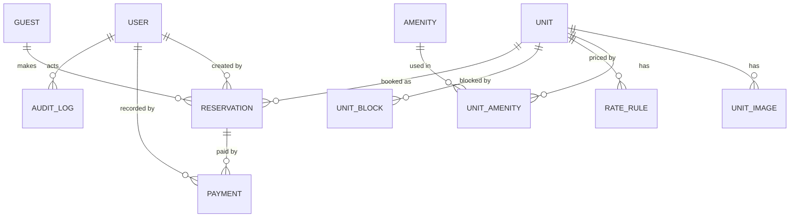

# Database Design — Sagara Villas

- **Version:** 1.0
- **Database:** PostgreSQL
- **ORM:** Prisma
- **Related:** [PRD](PRD.md) (business rules `BR-xx`) · [API](API.md) · [SECURITY](../SECURITY.md) · [TESTING](TESTING.md)

---

## 1. Principles

1. **The database is the last line of defense.** Overlap, date order, and non-negative amounts are enforced by constraints, not only by application code.
2. **Dates are calendar dates.** Stay dates use `@db.Date` (no time, no timezone). The property timezone is `Asia/Makassar`.
3. **Money is whole IDR** stored as `Int`. No floating point.
4. **Snapshots over references** for prices: a reservation keeps its own price breakdown.
5. **Payments are append-only.** Corrections are voids, never deletes.
6. **Derived values are recomputed in the same transaction** that changes their inputs (`netPaidIdr`, `paymentStatus`).
7. **Minimal personal data.** No identity document numbers.

## 2. Entity Relationship Overview



## 3. Prisma Schema (target)

```prisma
generator client {
  provider = "prisma-client-js"
}

datasource db {
  provider  = "postgresql"
  url       = env("DATABASE_URL")  // pooled connection (runtime)
  directUrl = env("DIRECT_URL")    // direct connection (migrations)
}

enum UserRole          { ADMIN STAFF }
enum UnitStatus        { DRAFT ACTIVE ARCHIVED }
enum ReservationStatus { PENDING CONFIRMED CHECKED_IN CHECKED_OUT CANCELLED }
enum ReservationSource { WEBSITE ADMIN WHATSAPP PHONE OTHER }
enum PaymentStatus     { UNPAID PARTIAL PAID }
enum PaymentMethod     { CASH BANK_TRANSFER QRIS CARD_EXTERNAL OTHER }
enum PaymentKind       { PAYMENT REFUND }
enum BlockReason       { MAINTENANCE OWNER_USE OTHER }
enum AmenityCategory   { IN_VILLA OUTDOOR SERVICES }

model User {
  id               String    @id @default(cuid())
  email            String    @unique            // stored lowercase
  name             String
  passwordHash     String
  role             UserRole  @default(STAFF)
  isActive         Boolean   @default(true)
  failedLoginCount Int       @default(0)
  lockedUntil      DateTime?
  lastLoginAt      DateTime?
  createdAt        DateTime  @default(now())
  updatedAt        DateTime  @updatedAt

  reservations Reservation[] @relation("ReservationCreatedBy")
  payments     Payment[]     @relation("PaymentRecordedBy")
  auditLogs    AuditLog[]
}

model Unit {
  id              String     @id @default(cuid())
  slug            String     @unique
  status          UnitStatus @default(DRAFT)
  nameEn          String
  nameId          String
  summaryEn       String
  summaryId       String
  descriptionEn   String
  descriptionId   String
  maxGuests       Int
  bedrooms        Int
  bathrooms       Int
  areaSqm         Int?
  baseRateIdr     Int
  cleaningFeeIdr  Int        @default(0)
  minNights       Int        @default(1)
  maxNights       Int?
  isFeatured      Boolean    @default(false)
  sortOrder       Int        @default(0)
  createdAt       DateTime   @default(now())
  updatedAt       DateTime   @updatedAt

  images       UnitImage[]
  amenities    UnitAmenity[]
  rateRules    RateRule[]
  blocks       UnitBlock[]
  reservations Reservation[]

  @@index([status, sortOrder])
}

model UnitImage {
  id         String  @id @default(cuid())
  unitId     String
  path       String                      // e.g. /images/units/garden-1.webp
  altEn      String
  altId      String
  isCover    Boolean @default(false)
  sortOrder  Int     @default(0)
  // Asset manifest (see CONTENT_GUIDE §8)
  source     String
  license    String
  credit     String?
  obtainedOn DateTime? @db.Date

  unit Unit @relation(fields: [unitId], references: [id], onDelete: Cascade)

  @@index([unitId, sortOrder])
}

model Amenity {
  id       String          @id @default(cuid())
  key      String          @unique        // e.g. "air_conditioning"
  nameEn   String
  nameId   String
  category AmenityCategory
  icon     String?                        // lucide icon name

  units UnitAmenity[]
}

model UnitAmenity {
  unitId    String
  amenityId String
  unit      Unit    @relation(fields: [unitId], references: [id], onDelete: Cascade)
  amenity   Amenity @relation(fields: [amenityId], references: [id], onDelete: Restrict)

  @@id([unitId, amenityId])
}

model RateRule {            // P1: seasonal override; most specific, latest wins
  id             String   @id @default(cuid())
  unitId         String
  label          String
  startDate      DateTime @db.Date
  endDate        DateTime @db.Date          // inclusive
  nightlyRateIdr Int
  minNights      Int?
  createdAt      DateTime @default(now())

  unit Unit @relation(fields: [unitId], references: [id], onDelete: Cascade)

  @@index([unitId, startDate, endDate])
}

model UnitBlock {
  id          String      @id @default(cuid())
  unitId      String
  startDate   DateTime    @db.Date
  endDate     DateTime    @db.Date          // exclusive, same [start,end) semantics
  reason      BlockReason
  note        String?
  createdById String?
  createdAt   DateTime    @default(now())

  unit Unit @relation(fields: [unitId], references: [id], onDelete: Cascade)

  @@index([unitId, startDate, endDate])
}

model Guest {
  id              String   @id @default(cuid())
  fullName        String
  email           String?
  emailNormalized String?  @unique          // lowercase/trimmed; null if absent
  phone           String?
  phoneNormalized String?                   // digits with country code
  country         String?                   // ISO 3166-1 alpha-2
  preferredLocale String   @default("en")
  notes           String?
  createdAt       DateTime @default(now())
  updatedAt       DateTime @updatedAt

  reservations Reservation[]

  @@index([phoneNormalized])
  @@index([fullName])
}

model Reservation {
  id                 String            @id @default(cuid())
  code               String            @unique   // e.g. SGV-2611-K7P2
  version            Int               @default(1) // optimistic concurrency
  unitId             String
  guestId            String
  status             ReservationStatus @default(PENDING)
  source             ReservationSource @default(WEBSITE)
  checkIn            DateTime          @db.Date
  checkOut           DateTime          @db.Date
  nights             Int
  adults             Int
  children           Int               @default(0)

  nightlySubtotalIdr Int
  cleaningFeeIdr     Int               @default(0)
  discountIdr        Int               @default(0)
  totalIdr           Int
  netPaidIdr         Int               @default(0) // derived
  paymentStatus      PaymentStatus     @default(UNPAID) // derived
  pricingSnapshot    Json                           // per-night breakdown

  locale             String            @default("en")
  specialRequests    String?
  internalNotes      String?
  confirmedAt        DateTime?
  checkedInAt        DateTime?
  checkedOutAt       DateTime?
  cancelledAt        DateTime?
  cancelReason       String?
  createdById        String?
  createdAt          DateTime          @default(now())
  updatedAt          DateTime          @updatedAt

  unit      Unit      @relation(fields: [unitId], references: [id], onDelete: Restrict)
  guest     Guest     @relation(fields: [guestId], references: [id], onDelete: Restrict)
  createdBy User?     @relation("ReservationCreatedBy", fields: [createdById], references: [id])
  payments  Payment[]

  @@index([unitId, checkIn, checkOut])
  @@index([status, checkIn])
  @@index([paymentStatus])
  @@index([guestId])
}

model Payment {
  id            String        @id @default(cuid())
  reservationId String
  kind          PaymentKind   @default(PAYMENT)
  amountIdr     Int                              // always > 0; kind decides sign
  method        PaymentMethod
  paidAt        DateTime                         // when money moved (timestamp)
  reference     String?                          // transfer ref, receipt no.
  note          String?
  recordedById  String
  createdAt     DateTime      @default(now())
  voidedAt      DateTime?
  voidReason    String?
  voidedById    String?

  reservation Reservation @relation(fields: [reservationId], references: [id], onDelete: Restrict)
  recordedBy  User        @relation("PaymentRecordedBy", fields: [recordedById], references: [id])

  @@index([reservationId])
  @@index([paidAt])
}

model AuditLog {
  id         String   @id @default(cuid())
  actorId    String?
  action     String                           // e.g. "reservation.confirm"
  entityType String
  entityId   String
  metadata   Json?                            // changed fields; no secrets, no passwords
  createdAt  DateTime @default(now())

  actor User? @relation(fields: [actorId], references: [id], onDelete: SetNull)

  @@index([entityType, entityId])
  @@index([createdAt])
}
```

> Auth.js with the Credentials provider and JWT sessions needs no extra tables. If the adapter strategy changes, add the tables in a separate migration and document it here.

## 4. Constraints Prisma Cannot Express

Create the migration with `prisma migrate dev --create-only`, then add this SQL by hand and commit it.

```sql
CREATE EXTENSION IF NOT EXISTS btree_gist;

-- BR-04: no overlapping blocking reservations per unit
ALTER TABLE "Reservation"
  ADD CONSTRAINT reservation_no_overlap
  EXCLUDE USING gist (
    "unitId" WITH =,
    daterange("checkIn", "checkOut", '[)') WITH &&
  )
  WHERE ("status" IN ('CONFIRMED', 'CHECKED_IN', 'CHECKED_OUT'));

-- BR-02 and sanity checks
ALTER TABLE "Reservation"
  ADD CONSTRAINT reservation_dates_valid CHECK ("checkOut" > "checkIn"),
  ADD CONSTRAINT reservation_nights_matches CHECK ("nights" = ("checkOut" - "checkIn")),
  ADD CONSTRAINT reservation_guests_valid CHECK ("adults" >= 1 AND "children" >= 0),
  ADD CONSTRAINT reservation_amounts_valid CHECK (
    "nightlySubtotalIdr" >= 0 AND "cleaningFeeIdr" >= 0 AND
    "discountIdr" >= 0 AND "totalIdr" >= 0
  );

ALTER TABLE "UnitBlock"
  ADD CONSTRAINT unit_block_dates_valid CHECK ("endDate" > "startDate");

ALTER TABLE "RateRule"
  ADD CONSTRAINT rate_rule_dates_valid CHECK ("endDate" >= "startDate");

ALTER TABLE "Payment"
  ADD CONSTRAINT payment_amount_positive CHECK ("amountIdr" > 0);
```

The application translates the exclusion-constraint violation (SQLSTATE `23P01`) into the API error `DATE_CONFLICT`.

## 5. Transaction Recipes

### 5.1 Confirm / create a blocking reservation

1. `BEGIN`.
2. Lock the unit row: `SELECT id FROM "Unit" WHERE id = $1 FOR UPDATE`.
3. Check `UnitBlock` overlap for `[checkIn, checkOut)` (app-level, because blocks are a separate table).
4. Update status / insert row. The exclusion constraint is the final guard.
5. Write `AuditLog`. `COMMIT`.

### 5.2 Record or void a payment

1. `BEGIN`; lock the reservation row (`FOR UPDATE`).
2. Insert the payment (or set `voidedAt`, `voidReason`, `voidedById`).
3. Recompute `netPaidIdr` and `paymentStatus` from non-voided payments.
4. Update the reservation, bump `version`, write `AuditLog`. `COMMIT`.

### 5.3 Payment status function (BR-09)

```ts
export function derivePaymentStatus(totalIdr: number, netPaidIdr: number) {
  if (totalIdr === 0) return "PAID"; // complimentary stay
  if (netPaidIdr <= 0) return "UNPAID";
  return netPaidIdr >= totalIdr ? "PAID" : "PARTIAL";
}
```

`netPaidIdr = Σ(PAYMENT, not voided) − Σ(REFUND, not voided)`. If `netPaidIdr > totalIdr` the status is `PAID` and the UI shows an **overpaid** indicator with the difference.

### 5.4 Payment status transition table (use as test data)

|     total | payments (non-voided)      |       net | status                  |
| --------: | -------------------------- | --------: | ----------------------- |
| 3,000,000 | none                       |         0 | UNPAID                  |
| 3,000,000 | +1,000,000                 | 1,000,000 | PARTIAL                 |
| 3,000,000 | +1,000,000, +2,000,000     | 3,000,000 | PAID                    |
| 3,000,000 | +3,000,000, refund 500,000 | 2,500,000 | PARTIAL                 |
| 3,000,000 | +3,500,000                 | 3,500,000 | PAID (overpaid 500,000) |
| 3,000,000 | +3,000,000, then void it   |         0 | UNPAID                  |
|         0 | none                       |         0 | PAID                    |

## 6. Pricing Calculation

For each night `d` in `[checkIn, checkOut)`: rate = most specific `RateRule` covering `d`, else `Unit.baseRateIdr`.

```text
nightlySubtotalIdr = Σ rate(d)
totalIdr           = nightlySubtotalIdr + cleaningFeeIdr − discountIdr   (never below 0)
pricingSnapshot    = { nights: [{date, rateIdr, ruleLabel?}], cleaningFeeIdr, discountIdr }
```

Re-pricing happens only when dates, unit, or discount change, and always writes a new snapshot.

## 7. Indexing and Query Notes

| Query                                       | Supporting index                         |
| ------------------------------------------- | ---------------------------------------- |
| Calendar: reservations overlapping a window | `Reservation(unitId, checkIn, checkOut)` |
| Reservation list by status/date             | `Reservation(status, checkIn)`           |
| Outstanding balances                        | `Reservation(paymentStatus)`             |
| Guest history                               | `Reservation(guestId)`                   |
| Payment report by date                      | `Payment(paidAt)`                        |
| Audit by entity                             | `AuditLog(entityType, entityId)`         |

Guest text search (P1): add `pg_trgm` and a GIN index on `fullName`.

Aggregates over large sums: confirm `_sum` behavior on `Int` in Milestone 7; if it overflows or truncates, use raw SQL with `::bigint` and convert in the service layer. A single reservation is limited to roughly 2.1 billion IDR by `Int`.

## 8. Reservation Code

Format `SGV-YYMM-XXXX` where `XXXX` is 4 characters from `ABCDEFGHJKMNPQRSTUVWXYZ23456789` (no look-alike characters). Generate on insert and retry on unique violation. The code is a reference for humans and is **not a secret**; never use it to authorize access.

## 9. Seed Data (fictional only)

- 1 `ADMIN` created from `SEED_ADMIN_EMAIL` and `SEED_ADMIN_PASSWORD` (required env vars; no default password; seeding refuses to run with production env without an explicit flag).
- 1 `STAFF` user for demo (password from env).
- 4–5 units with bilingual text and illustrative rates.
- Amenities catalog with bilingual names.
- ~40 reservations across past and future covering every status and payment state; dates generated relative to "today" so the demo never goes stale.
- Guests use invented names, `@example.com` emails, and obviously fictional phone numbers.

## 10. Migrations Policy

- Development: `prisma migrate dev`. Production: `prisma migrate deploy` only.
- One migration per logical change; never edit an applied migration.
- Destructive changes (drop/rename) use expand-and-contract across two releases.
- Hand-written SQL migrations live beside generated ones and are reviewed.

## 11. Data Retention (documented approach)

- Reservations and payments: keep (they are the business record).
- Guest personal data: provide an admin **anonymize** action (replace name/email/phone with placeholders) for guests with no reservation in the retention window; keeps financial records intact.
- Audit log: keep; it must never contain passwords or tokens.
- For a real client, retention periods require review under applicable law (for Indonesia, Law No. 27 of 2022 on Personal Data Protection) by a qualified professional.
